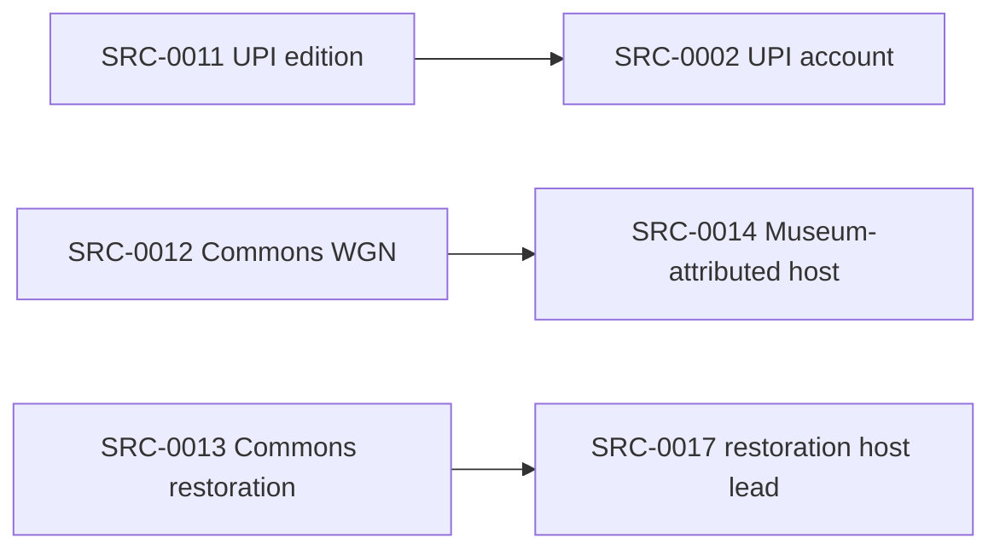

# Source-dependency map

Date: 2026-11-08. Status: available initial source map; underlying interview, record and capture
relationships retain named gaps. The [source register](../../registers/sources.csv) owns current
parent links; this dated view records the inspected basis rather than a second editable register.

Input revisions: SRC-0001/0002/0004-0007 revision2; SRC-0003/0008-0010 revision3;
SRC-0011-0017 revision1; CLM-0002 revision2, with CLM-0001 and CLM-0003-0020 revision1.
Retrieval/coverage history is in SRCH-0001-0049.

## Item and account map

| Source | Item/date and inspected basis | Dependence and remaining limits |
| --- | --- | --- |
| SRC-0001 r2 (S01) | WTTW retrospective,2017-11-21; article text | Staff recollections; shared Skierkiewicz witness with SRC-0004. Interview-session relationship unknown; media and underlying records unverified. |
| SRC-0002 r2 (S02) | UPI,1987-11-23; indexed text, CLM-0001/0004/0005 | Publisher request blocked. Original page/image and reporting notes unavailable. |
| SRC-0003 r3 (S03) | WBUR transcript, recorded publication precision2019; inspected portions, CLM-0008 | Publisher describes editorial adjustment. Original interview/media and relationships to earlier reporting remain unverified; allegations are not adopted. |
| SRC-0004 r2 (S04) | Criminal153,2020-11-20; extracted PDF text, CLM-0003 | Transcript-error warning; audio uninspected. Shared witness with SRC-0001 does not establish separate testimony. |
| SRC-0005 r2 (S05) | FuzzyMemories undated listing; CLM-0006/0007 | Description and displayed duration only; capture, edits and independence unknown. |
| SRC-0006 r2 (S06) | CPL guide lead; browser barrier | No historical issue holding or access confirmed. |
| SRC-0007 r2 (S07) | FOIA.gov process text; publication date unknown | General process guidance, with no incident record or custodian confirmed. |
| SRC-0008 r3 | Tribune clipping; archive-attributed1987-11-24; two protected images AST-0001; CLM-0009-0014 | Byline/continuation inspected; issue masthead absent. Underlying engineering/FCC records and reporting-source relationships unverified. |
| SRC-0009 r3 | Sun-Times clipping; archive-attributed1987-11-24; AST-0002; CLM-0015-0017 | Image comparison corrects archive OCR. Edition/source chain remains unknown. |
| SRC-0010 r3 | Electronic Media,1987-11-30; printed4/87 (PDF6/89), AST-0003; CLM-0018-0020 | Visible issue date/byline/continuation checked. News accounts and station comments require claim-level dependence assessment. |
| SRC-0011 r1 | UPI,1987-11-24; indexed text | Canonical parent SRC-0002: overlapping UPI reporting/witness wording; separate edition does not add independent testimony. |
| SRC-0012 r1 | Commons WGN metadata,2018-12-15 | Declared host parent SRC-0014. Metadata was inspected; file bytes/playback and capture chain were not. |
| SRC-0013 r1 | Commons WTTW restoration metadata,2025-11-27 | Declared host parent SRC-0017. Restoration/caption/upscale labels leave processing and original detail unknown. |
| SRC-0014 r1 | Museum-attributed WGN YouTube lead; date unknown | Publisher fetch failed. Attribution is traced to Commons; original tape/capture remains unverified. |
| SRC-0015 r1 | WTTW YouTube title/embedded lead; date unknown | “Original Upload” is a title. No verified tape history, description or playback. |
| SRC-0016 r1 | WTTW partner-player retrospective lead; date unknown | Potential excerpts; fetched player offered no usable body or inspected playback. |
| SRC-0017 r1 | YouTube restoration lead; date unknown | Linked from Commons. Fetch failed; no verified processing algorithm or capture independence. |

## Recorded relationships

Arrows mean **child item → declared parent item/host**, using current canonical links. They do
not assert a complete physical-tape family tree.

SRC-0001 and SRC-0004 share a witness, but no canonical parent edge has been invented between
their publications. Different reporters can also rely on common station or investigator accounts;
independence must be established for each proposition. An empty parent list records no established
edge and does not demonstrate an independent interview, capture or original record.

AST-0001/0002/0003 are acquired copies of documentary publications. Their page-render derivatives
retain those inputs; repeated renderings add no testimony. The metadata-only recording leads have
no acquired broadcast AST or established independent capture family. See the
[recording inventory](../media-comparison/recording-inventory.md) for their distinct limits.

## Coverage and next evidence

SRCH-0010-0019 document the defined1987-11-23–30 available-index newspaper/trade survey; they do
not establish exhaustive issue coverage. Later protected-image checks are recorded in
[image-text-check.md](image-text-check.md). SRCH-0020-0046 cover bounded recording discovery and
its failed fetches; pooled search results retain uncertain per-query attribution. SRCH-0047 is a
later follow-up query, and SRCH-0048/0049 retain the engineering-document gaps.

Next evidence should distinguish underlying interview sessions, original publication context and
independent reception captures. The owner controls restricted holdings, personal copies and any
contact. New parent/capture claims require inspectable provenance before canonical links change.
Separate review of this populated map remains part of the baseline milestone.
