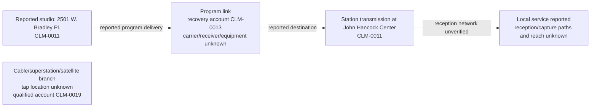
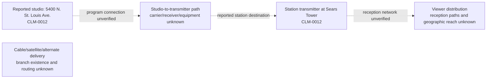

# Reported 1987 station signal paths

Date: 2026-11-08. Status: available partial documentary baseline, with unsupported components
marked unknown. These are attributed contemporary-report relationships. No as-built equipment
configuration, intruder site, power value or mechanism conclusion is established.

## Dated evidence and inspection

SRC-0008 r3 is an archive-attributed 1987-11-24 Tribune clipping; its two images lack an issue-date
masthead. AST-0001 PDF page 2 contains the location/map and recovery passages behind CLM-0011-0014 r1.
The image reports WGN studios at 2501 W. Bradley Place and transmission from John Hancock Center, and
WTTW studios at 5400 N. St. Louis Avenue with its transmitter at Sears Tower. It attributes WGN recovery
to changing the program-link frequency and describes WTTW checking internal video sources.

SRC-0010 r3 has a visible 1987-11-30 issue date. AST-0003 printed pages 4/87 (PDF pages 6/89) supports
CLM-0018-0020 r1. Its local/cable account is tentative: it reports local WGN picture intrusion,
while cable-superstation picture absence and a possible dark feed are qualified accounts.
Uniform reception impact or a definitely normal cable feed is not established.

The author inspected rendered AST-0005/0007/0010 against these citations. The original acquisitions
and rendering method are recorded in [image-text-check](../chronology/image-text-check.md).
Confidence remains moderate for the attributed accounts; SHA-256 confirms preserved bytes.

## WGN-TV

Dashed arrows show reported functional routing with hardware details unresolved. Node locations
concern the station's facilities, not the intrusion's source. Distribution branch boxes are left
unattached because their tap locations are unknown.

## WTTW

## Components still unresolved

| Component | WGN-TV | WTTW | Evidence needed |
| --- | --- | --- | --- |
| Studio output and switching | Reported origin; exact bus/tap unknown | Reported origin; scope of internal check unknown (CLM-0014) | Dated switching diagram and incident log |
| Studio-to-transmitter link | Functional delivery/recovery account; actual carrier, receiver and antenna unknown | Physical/program topology and receiver behavior unknown | 1987 licensing, equipment and link documentation |
| Monitoring | Studio versus off-air tap, recording and clock unknown | Monitor taps and alarm recording unknown | Dated monitoring arrangements and first-person feed identification |
| Remote control | Controls, location, timing and recovery sequence unknown | Controls, availability and recovery sequence unknown | Control configuration, procedures and action log |
| Alternate feeds | Routing and activation unknown | Routing and activation unknown | Dated redundancy/switching records |
| Distribution | Local/cable account remains qualified (CLM-0019) | Affected distribution paths unestablished | Historical tap/headend routes and independent reception captures |

SRCH-0048/0049 did not establish the required dated equipment/as-built documents; this is a
bounded search limit, not their nonexistence. Current facilities have not filled these gaps.
See [assumptions](assumptions.md) and the [conditional explanation comparison](explanation-comparison.md).
No RF budget, feasibility range, transmitting-site deduction or live experiment was performed.
